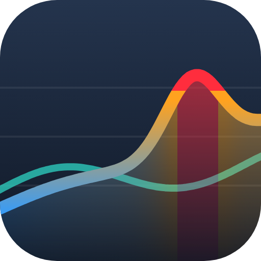
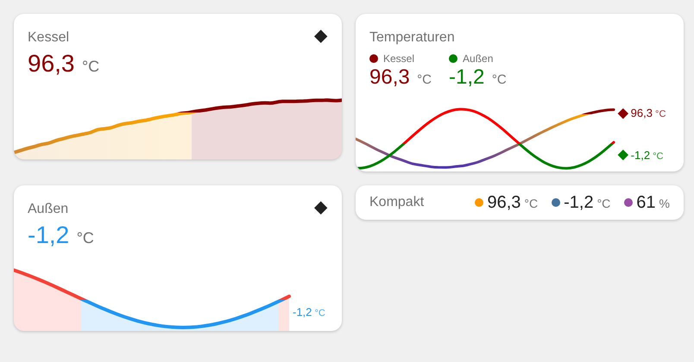

<p align="center"></p>

# Best Number Card

A Home Assistant dashboard card that looks and behaves like the built-in **sensor card**, with these additions:



- **Multiple entities** in one card, each with its own line
- **Color scales per series**: gradients, hard steps, or both (e.g. gradient up to 95 °C, then a jump to dark red), with optional **dashed lines at the jumps**
- **Separate y-axes** (scale groups) for series with different units or ranges, with **y-axis labels** on hover or permanently
- **Labels at the end of each line** (current value and/or icon) that move with the latest value
- **Min / average / max** of the visible time range, without any extra query
- **Min/max band**: a shaded band shows the real range around the line. For long time ranges it comes straight from the long-term statistics.
- **Time axis** with relative labels ("−6 h … now"), on hover or always
- **Attributes** instead of the state, for example the target temperature of a thermostat
- **Tap a legend entry** to temporarily hide its line
- **Alert glow**: the whole card glows, pulses or blinks while a value reaches its alert threshold.
- **Hide entities depending on their value**. A hidden entity is not shown and its history is not loaded at all.
- **Compact mode**: values only, minimal height, no history loaded. Optionally with the card icon, entity names and a faint graph in the background. It can be the default, or you can toggle it by tapping the card. The toggled state is remembered on each device.
- **Tooltip** on hover, and on phones by **swiping across the graph**
- **Visual editor** in English and German, with a color picker (theme colors + custom color), color scale preview, presets, drag & drop sorting, warnings and performance hints. The language follows your Home Assistant language.
- **Very light on your system**, even for long windows of dense data (see [Performance](#performance))
- Shows up in Home Assistant's **card suggestions** when you add a card for a numeric sensor (HA 2026.6 or newer)

## Comparison with the built-in sensor card

| | Sensor card | Best Number Card |
|---|---|---|
| Entities per card | 1 | any number |
| Look (name, icon, big value, graph at the bottom) | ✓ | ✓ same layout |
| `graph`, `detail`, `hours_to_show`, `limits`, `unit`, `name`, `icon`, `theme` | ✓ | ✓ |
| Visual editor | ✓ | ✓ with color scale preview, presets, drag & drop, warnings |
| Line color | fixed | per series, or a **color scale** by value |
| Color scale with gradients and hard jumps | – | ✓ also colors the fill, the value and the marker |
| Fill colored along time (vertical bands) | – | ✓ `fill_gradient: time` |
| Dashed lines at color jumps | – | ✓ `show_thresholds` |
| Separate y-axes | – | ✓ scale groups |
| Y-axis labels | – | ✓ on hover or always |
| Time axis | – | ✓ on hover or always |
| Min/max band | – | ✓ from long-term statistics, no extra query |
| Attributes instead of the state | – | ✓ e.g. a thermostat's target temperature |
| Tooltip with time and value | – | ✓ mouse and touch |
| Labels / icons at the end of the lines | – | ✓ |
| Min / avg / max of the time range | – | ✓ `show_extrema` |
| Hide a line by tapping the legend | – | ✓ |
| Hide entities depending on their value | – | ✓ and their history is not loaded |
| Alert: card glows / blinks at a threshold | – | ✓ `alert_above` / `alert_below` |
| Compact mode (values only) | – | ✓ default or tap to toggle, remembered per device |
| Tap / hold / double-tap actions | more info on tap | ✓ all standard actions, plus `toggle-compact` |
| Loading of long time ranges | raw history | **long-term statistics** + short raw tail |
| Several cards / views showing the same entity | each loads separately | shared in-memory cache, only the gap is loaded |
| Redraws with very dense sensors | on every update | throttled to what is visible (about one pixel) |
| Loading placeholder | – | ✓ |
| Number format (e.g. German decimal comma) | ✓ | ✓ follows your HA settings |

## Installation

### HACS (recommended)

1. HACS → ⋮ → *Custom repositories* → add `https://github.com/zitroaen/bestnumbercard`, category **Dashboard**.
2. Install **Best Number Card**.
3. Reload the browser.

HACS registers the dashboard resource for you. It adds a `?hacstag=…` version parameter to the resource URL, so after every update the browser loads the new version automatically. **You never have to clear any cache.** A normal reload of the page is enough. The card writes its version to the browser console (`BEST-NUMBER-CARD vX.Y.Z`), so you can check which version is running.

### Manual

Copy `dist/best-number-card.js` to `<config>/www/` and add the resource `/local/best-number-card.js?v=0.1.0` (type *JavaScript module*). Increase `?v=` with every update.

## Configuration

Everything can be configured in the visual editor. YAML example:

```yaml
type: custom:best-number-card
name: Heating
hours_to_show: 24
end_labels: icon_value
entities:
  - entity: sensor.boiler_temperature
    color_scale:
      - { value: 20, color: blue }
      - { value: 95, color: orange }   # gradient blue → orange …
      - { value: 95, color: darkred }  # … hard jump at 95
  - entity: sensor.outdoor_temperature
    scale: outdoor                     # own y-axis
    color_scale:                       # green below 0, red otherwise
      - { value: 0, color: green }
      - { value: 0, color: red }
  - entity: sensor.fireplace_temperature
    hide_below: 40                     # hidden and not loaded while < 40
```

### Card options

| Option | Default | Description |
|---|---|---|
| `entities` | – | List of entity ids or entity objects (see below) |
| `name` / `icon` | entity's | Header name and icon |
| `graph` | `line` | `line` or `none` |
| `detail` | `1` | `1` = smooth average, `2` = high detail, keeps every peak (min/max per pixel) |
| `hours_to_show` | `24` | Time window |
| `height` | auto | Graph height in px. By default the graph uses the free space of the card (sections dashboards with a fixed card height) and otherwise has the height of the sensor card's graph. |
| `limits` | – | `{min, max}` for all scales (like the sensor card) |
| `smoothing` | `true` | Smooth curves |
| `fill_gradient` | `value` | Default for all entities, see `fill_gradient` below |
| `value_display` | `primary` (1 entity) / `all` | `primary` = like the sensor card, `all` = all values, `none` |
| `legend_icon` | `dot` | Marker next to the values: `dot`, `icon`, `none` |
| `end_labels` | `none` | Label at the end of each line: `none`, `value`, `icon`, `icon_value` |
| `tooltip` | `true` | Tooltip on hover. On touch screens: swipe horizontally across the graph. |
| `y_axis` | `hover` | Min/max labels of each y-axis: `hover`, `always`, `none` |
| `font_size` | layout default | Font size of the values in px (can be set per entity) |
| `x_axis` | `hover` | Relative time labels below the graph: `hover`, `always`, `none` |
| `band` | `false` | Shaded min/max band around every line (can be set per entity) |
| `show_thresholds` | `false` | Dashed lines with labels at the hard jumps of the color scales |
| `show_extrema` | `false` | Show min / average / max of the visible time range below each value |
| `legend_toggle` | `true` | Tap an entity name in the header to hide or show its line |
| `compact` | `false` | Start in compact mode |
| `compact_icon` | `false` | Compact mode: show the card icon |
| `compact_names` | `false` | Compact mode: show the entity names (small, above the values) |
| `compact_graph` | `false` | Compact mode: faint graph in the background. This loads the history, which compact mode otherwise doesn't. |
| `remember_compact` | `true` | Remember a compact mode toggled by tapping, per device |
| `statistics_threshold` | `6` | Use long-term statistics if `hours_to_show` is larger than this |
| `statistics_period` | `auto` | `auto`, `5minute`, `hour`, `day` |
| `alert_style` | `glow` | Effect while an entity is in alert: `glow` (pulsing), `blink`, `static` (steady glow) |
| `alert_color` | theme error color | Color of the alert glow |
| `theme` | – | Theme for this card |
| `tap_action` | `more-info` | Standard HA actions, plus `toggle-compact` |
| `hold_action` / `double_tap_action` | – | Standard HA actions, plus `toggle-compact` |

When the tap action is `more-info`, tapping a value opens that value's entity.

### Entity options

| Option | Description |
|---|---|
| `entity` | Entity id |
| `attribute` | Show this attribute instead of the state, e.g. `temperature` of a `climate` entity. Attributes have no long-term statistics, so their history is always loaded with attributes. |
| `band` | Min/max band for this line (overrides the card option) |
| `show_extrema` | Min / avg / max below this value (overrides the card option) |
| `font_size` | Font size of this value in px |
| `raw_history` | Always load the **full raw history**, so every short peak is visible, like in the built-in card. This puts more load on the system. For long time ranges the fast statistics are shown as a preview until the details have arrived. |
| `name`, `icon`, `unit` | Overrides |
| `decimals` | Number of decimals (default: the entity's display precision) |
| `color` | Line color without a color scale (any CSS color, also `var(--red-color)`) |
| `color_scale` | List of `{value, color}` stops |
| `color_scale_mode` | `gradient` (default) or `step` |
| `scale` | Scale group. Series with the same name share a y-axis (default: all share one) |
| `min` / `max` | Fixed limits for this series' scale |
| `fill` | Fill the area under the line (default: only with a single series) |
| `fill_gradient` | How the color scale colors the fill: `value` = by height (horizontal color bands), `time` = each point in time gets the color of its value (vertical color bands) |
| `line_width` | Line width in px |
| `show_value` / `show_graph` | Show this entity in the header / in the graph |
| `hide_below` / `hide_above` | Hide the entity completely while its value is below / above this value |
| `hide_unavailable` | Hide the entity while it is unavailable |
| `alert_above` / `alert_below` | The whole card glows while the value is at or above / at or below this value |

#### Color scales

The stops are sorted by value. The color applies to the line, the fill area, the value and the marker.

- **gradient**: colors are interpolated between neighbouring stops. Two stops with the **same value** form a hard jump, just like in CSS gradients. In the editor, use the jump button of a stop instead: you then pick the color below and above the value.
- **step**: each stop's color applies from its value upwards. The first color also applies below the first stop.

Below the first stop and above the last stop, the first and last color are used.

The editor shows a live preview bar of the scale and has presets: room temperature, outdoor temperature, heating, humidity, CO₂ and battery.

By default the fill area uses the same height-based coloring as the line, which gives horizontal color bands. With `fill_gradient: time`, the fill below the line is colored along the time axis instead, so you can see at a glance *when* a threshold was exceeded.

#### Alert

```yaml
type: custom:best-number-card
alert_style: glow          # glow | blink | static
alert_color: var(--red-color)
entities:
  - entity: sensor.boiler_temperature
    alert_above: 95
```

The glow is a layer above the card whose opacity is animated. Browsers run this on the GPU, so it costs almost no CPU, even on wall tablets. If *reduce motion* is enabled in the operating system, the card glows steadily instead of pulsing.

## Performance

The card is built to put as little load as possible on Home Assistant and the browser:

- **Windows up to `statistics_threshold` (6 h):** a single `history/stream` subscription for all entities, with `minimal_response`, `no_attributes` and `significant_changes_only`. Home Assistant sends the history once and then only pushes new values. Updates that only change attributes are filtered out on the server. There is no polling.
- **Longer windows:** the card uses Home Assistant's **pre-aggregated long-term statistics** (5 min / hourly / daily), fetched in one request. Raw history is only streamed for the few minutes after the last statistics bucket. Entities without statistics (no `state_class`) automatically fall back to raw history.
- **In-memory cache per entity:** when you switch dashboard views or open the same entity in several cards, nothing is fetched twice. Cards that show the same entity also **share one live subscription** and one statistics request. Only the gap since the card was last visible is loaded. The cache lives only in the open browser tab, so it can never become stale across updates.
- **Reconnects:** when the connection to Home Assistant drops, for example when a tablet wakes up, only the missing gap is requested again instead of the whole time range.
- **Long-running dashboards:** points that scrolled out of the time range are dropped regularly, so memory stays flat even after days. In a background tab the graph is not redrawn at all.
- **Rendering:** data is aggregated to about one point per pixel in O(n), with time-weighted means and no lost peaks in `detail: 2`. Redraws are throttled to the time span one pixel represents, so even very dense sensors do not cause constant redraws. Header values update immediately.
- Hidden entities and cards in compact mode do not load any history.
- **Loading in stages:** first a flat line with a glow running over it, then the fast statistics as a preview, then the details. The glow stops when everything is loaded. Users with *reduce motion* don't get the animation.
- The editor warns you when a sensor has no long-term statistics, because long time ranges then have to load the raw history.

## Troubleshooting

If a graph stays empty or shows "History could not be loaded":

1. Open the browser console (F12 → Console). The card logs failed requests there, together with the error message from Home Assistant.
2. For details about every request, enable the debug output in the console and reload the page:

   ```js
   localStorage.setItem("best-number-card-debug", "1")
   ```

   The card then logs each history subscription and how many states Home Assistant sent back. Turn it off with `localStorage.removeItem("best-number-card-debug")`.
3. Check that the entity is recorded by the recorder, i.e. not excluded in `recorder:`. Otherwise there is no history to show.

## Development

```bash
npm install
npm run build      # → dist/best-number-card.js
npm test
npm run watch
```

### Release

Releases are automatic. Every change to the card needs a new version (patch for fixes, minor for features), and a CI check enforces this. Bump `version` in `package.json`, run `npm run build` and commit, including `dist/`. When the change lands on `main`, the release workflow creates the GitHub release `vX.Y.Z` with `best-number-card.js` attached, and HACS then offers the update. You can also start the workflow by hand under *Actions → Release → Run workflow*.
